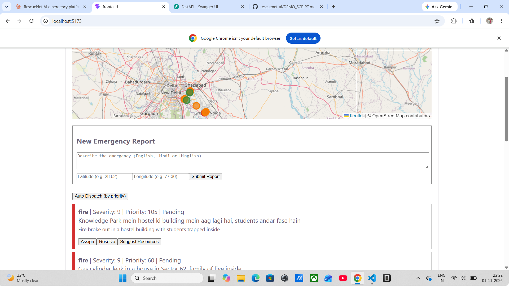
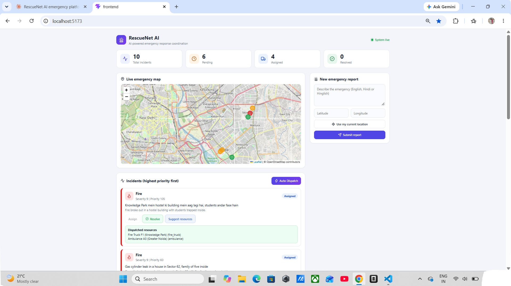

# RescueNet AI

AI-powered emergency management platform. It classifies emergency reports, estimates severity, ranks incidents by priority, and suggests the nearest rescue resources.

> Academic prototype. Final decisions must be verified by a human operator.

## Features

- AI incident analysis (type, severity, people at risk, summary) using Gemini
- Smart priority engine: priority = severity x 5 + people at risk x 3
- Live emergency map with priority colours
- Status workflow: Pending, Assigned, Resolved
- Nearest resource recommendation (Haversine distance)
- Auto dispatch for multiple emergencies, highest priority first
- Works with Hindi, English and Hinglish reports

## Screenshots

**Before dispatch:** all emergencies are pending, ranked by AI priority.

**After Auto Dispatch:** the highest-priority emergencies get the nearest available resources.

## Tech Stack

- Backend: Python, FastAPI, SQLAlchemy
- Database: PostgreSQL
- AI: Google Gemini API
- Frontend: React (Vite), Leaflet map

## Setup

### 1. Backend

    cd backend
    python -m venv venv
    venv\Scripts\activate
    pip install -r requirements.txt

Copy `.env.example` to `.env` and fill in your Gemini API key and database password.
Create a PostgreSQL database named `rescuenet`, then:

    python seed.py
    uvicorn main:app --reload

### 2. Frontend

    cd frontend
    npm install
    npm run dev

Open http://localhost:5173

## Demo

Helper scripts (run from the `backend` folder with the virtual environment active):

    python demo_seed.py          # sends 10 sample emergency reports to the API
    python reset_demo.py         # sets all incidents to Pending and frees all resources
    python manage_incidents.py   # lists incidents with their IDs

Suggested flow: run `reset_demo.py`, open the dashboard, click **Auto Dispatch**, then **Resolve** one incident and click **Auto Dispatch** again to see freed resources reassigned.

Note: `demo_seed.py` calls the Gemini API once per report, so it is limited by the free-tier daily quota.
## Author

Karan Kumar Kanojiya